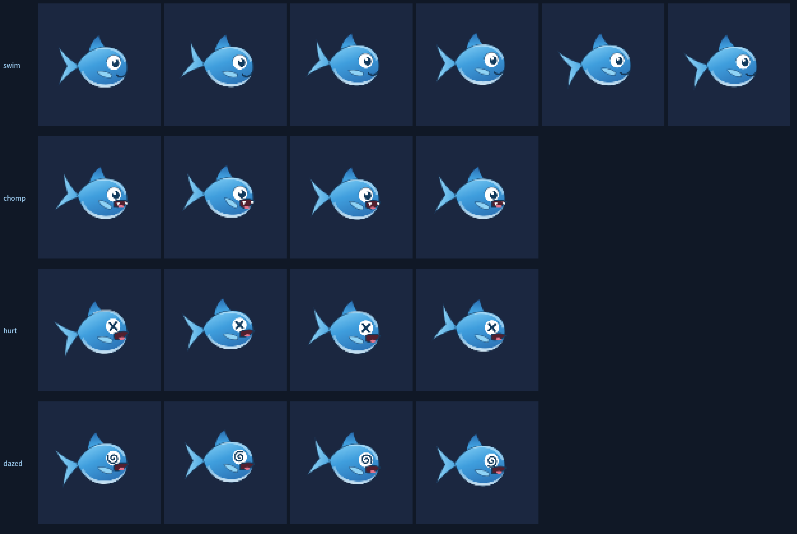

# DeepSeeker

把《蔚蓝》第五章（镜之寺庙）里追着人跑的 **Seeker** 换成一条蓝色大肥鱼。纯整活，DeepSeek + Seeker。



## 安装

1. 装好 [Everest](https://everestapi.github.io/)（能玩 mod 就行，版本 ≥ 1.4.0）。
2. 把 `DeepSeeker` 文件夹放进 `Celeste/Mods/`，或者直接把 `DeepSeeker-0.1.0.zip` 丢进 `Celeste/Mods/`。
3. 启动游戏。第五章的 seeker 全部变成肥鱼。

不需要开任何设置项，也不需要 Olympus。卸载就是删掉文件夹。

## 它改了什么

只替换贴图，不动代码、不动地图、不动原版图集文件：

- `Graphics/Atlases/Gameplay/characters/monsters/predator00.png` … `predator151.png`
- `Graphics/Atlases/Gameplay/characters/monsters/rebirth00.png` … `rebirth10.png`

这是 Everest 自带的能力：mod 里放在 `Graphics/Atlases/Gameplay/` 下的 png 会在加载时覆盖同名图集帧（`Atlas.Ingest` / `MTexture.SetOverride`）。每张图都是 **96x96**，和原版 seeker 帧的 frame size 完全一致，所以：

- 潜行 / 搜索 / 发现 / 冲刺 / 撞墙 / 被打晕 / 复活 / 从雕像里孵化，全部沿用原版动画和帧序；
- 朝向翻转（`sprite.Scale.X *= spriteFacing`）、受击抖动、缩放挤压也都是原版逻辑，肥鱼自动跟着走；
- 因为只是换帧，联机（MiaoNet）里别人的客户端没装也不会报错，只是他们看到的还是原版 seeker。

Shockwave 圈、雕像本体没有改，还是原版。想改的话往同一个目录里加对应帧名就行。

### 尺寸说明

`Gameplay.meta` 里 seeker 每帧的 frame size（也就是原图尺寸）是 **96×96**，但每帧都 trim 过，可见像素小得多：idle 帧约 26×25，最大 58×33（hatch 帧），作为对照玩家帧是 32×32。本 mod 的 png 同样是 96×96 画布，肥鱼可见部分约 47×33（比原版胖一圈），画布尺寸一致所以定位不会被缩放带偏。

## 贴图

`tools/gen_sprites.mjs` 用 `@napi-rs/canvas` 画出 4 组状态（游动 6 帧 / 咬人 4 帧 / 受伤 4 帧 / 眩晕 4 帧），再按原版帧号分发成 163 张 96x96 的 png。

```bash
npm i @napi-rs/canvas
node tools/gen_sprites.mjs
```

改颜色 / 改脸 / 改帧数都只动这个脚本，重跑一次就重新生成整套图。

## 限制

- 只在装了本 mod 的客户端生效（纯客户端贴图）。
- 没在实机上跑过截图（开发机上没有能跑起来的游戏 + 视频输出），贴图是按原版帧尺寸生成的预览图，进游戏后位置应该是对齐的；有错位请开 issue。
